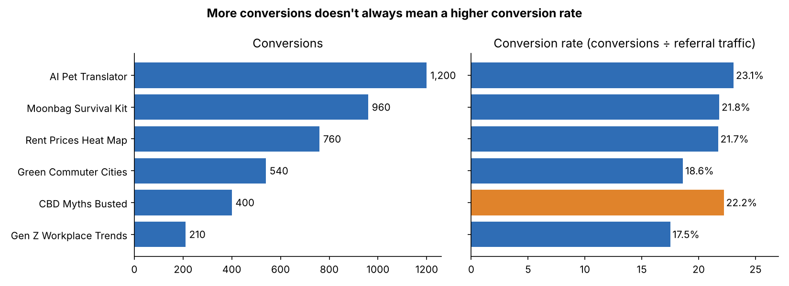
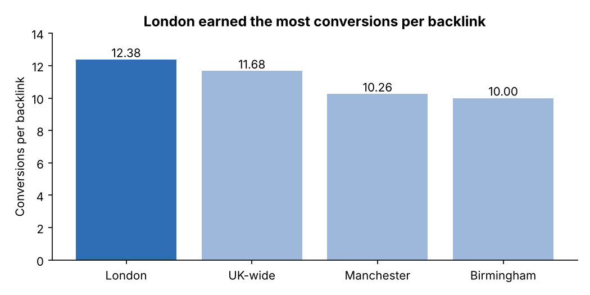

# UK Digital PR Campaign Analysis
## Introduction
- This project analyzes UK digital PR campaigns, measuring conversions, referral traffic, media mentions and backlink efficiency across regions.
- 🔝 The campaigns with the most conversions
- 📈 Referral traffic by campaign topic
- 📈 Ranking the campaigns by the most media mentions
- 🔝 Which region earned the most conversions per backlink



## Background
### Tools I used
- **BigQuery**: writing, testing and managing SQL queries
- **Python (matplotlib)**: charts
- **Git + GitHub**: version control and project sharing

### Data
- One BigQuery table, `PR_dataset.pr_metrics`, with one row per campaign (six UK digital PR campaigns).
- Columns: `campaign_name`, `topic`, `region`, `conversions`, `referral_traffic`, `media_mentions`, `backlinks`.
- In the queries below, replace `your-project` with your own Google Cloud project ID.

### Metrics
- **Conversion rate** = conversions ÷ referral traffic, shown as a percentage.
- **Conversions per backlink** = conversions ÷ backlinks. This is a ratio, not a percentage (12.38 means about 12 conversions for every backlink).

## The Analysis
Each query evaluates how effectively the campaigns turned traffic into conversions, earned backlinks and gained media visibility.

## 🔝 The campaigns with the most conversions

| Campaign Name | Conversions | Referral Traffic | Conversion Rate |
|---|---|---|---|
| AI Pet Translator | 1,200 | 5,200 | 23.1% |
| Moonbag Survival Kit | 960 | 4,400 | 21.8% |
| Rent Prices Heat Map | 760 | 3,500 | 21.7% |
| Green Commuter Cities | 540 | 2,900 | 18.6% |
| CBD Myths Busted | 400 | 1,800 | 22.2% |
| Gen Z Workplace Trends | 210 | 1,200 | 17.5% |

```sql
SELECT
  campaign_name,
  conversions,
  referral_traffic,
  ROUND(SAFE_DIVIDE(conversions, referral_traffic) * 100, 1) AS conversion_rate_pct
FROM `your-project.PR_dataset.pr_metrics`
ORDER BY conversions DESC;
```
### 💡 Insights
- Campaigns built around educational or utility tools (AI Pet Translator, Moonbag Survival Kit, Rent Prices Heat Map) drove the most conversions.

## 📈 Referral traffic by campaign topic

| Topic | Campaign Name | Referral Traffic |
|---|---|---|
| Tech | AI Pet Translator | 5,200 |
| Space | Moonbag Survival Kit | 4,400 |
| Real Estate | Rent Prices Heat Map | 3,500 |
| Sustainability | Green Commuter Cities | 2,900 |
| Cannabis | CBD Myths Busted | 1,800 |
| Career | Gen Z Workplace Trends | 1,200 |

```sql
SELECT
  topic,
  STRING_AGG(campaign_name, ', ') AS campaigns,
  SUM(referral_traffic) AS total_referral_traffic
FROM `your-project.PR_dataset.pr_metrics`
GROUP BY topic
ORDER BY total_referral_traffic DESC;
```

### 💡 Insights
- The Tech campaign earned the most referral traffic (5,200 visits), followed by Space and Real Estate.
- Each topic has only one campaign in this dataset, so this reflects individual campaigns rather than a proven pattern for each topic.

## 📈 Ranking the campaigns by the most media mentions

| Campaign Name | Media Mentions | Conversions | Referral Traffic | Conversion Rate |
|---|---|---|---|---|
| AI Pet Translator | 154 | 1,200 | 5,200 | 23.1% |
| Moonbag Survival Kit | 127 | 960 | 4,400 | 21.8% |
| Rent Prices Heat Map | 90 | 760 | 3,500 | 21.7% |
| Green Commuter Cities | 78 | 540 | 2,900 | 18.6% |
| CBD Myths Busted | 61 | 400 | 1,800 | 22.2% |
| Gen Z Workplace Trends | 52 | 210 | 1,200 | 17.5% |

```sql
SELECT
  campaign_name,
  media_mentions,
  conversions,
  referral_traffic,
  ROUND(SAFE_DIVIDE(conversions, referral_traffic) * 100, 1) AS conversion_rate_pct
FROM `your-project.PR_dataset.pr_metrics`
ORDER BY media_mentions DESC;
```

### 💡 Insights
- Campaigns with more media mentions also had more conversions: the order is the same in both columns.
- More mentions didn't always mean a higher conversion rate. CBD Myths Busted had the second-fewest mentions (61) but the second-highest conversion rate (22.2%), so a smaller campaign can still convert its visitors efficiently.

## 🔝 Which region earned the most conversions per backlink



**By region**

| Region | Campaigns | Conversions | Backlinks | Conversions per Backlink |
|---|---|---|---|---|
| London | 2 | 1,300 | 105 | 12.38 |
| UK-wide | 2 | 2,160 | 185 | 11.68 |
| Manchester | 1 | 400 | 39 | 10.26 |
| Birmingham | 1 | 210 | 21 | 10.00 |

```sql
SELECT
  region,
  COUNT(*) AS campaigns,
  SUM(conversions) AS conversions,
  SUM(backlinks) AS backlinks,
  ROUND(SAFE_DIVIDE(SUM(conversions), SUM(backlinks)), 2) AS conversions_per_backlink
FROM `your-project.PR_dataset.pr_metrics`
GROUP BY region
ORDER BY conversions_per_backlink DESC;
```

**By campaign**

| Region | Campaign Name | Conversions | Backlinks | Conversions per Backlink |
|---|---|---|---|---|
| London | Green Commuter Cities | 540 | 43 | 12.56 |
| London | Rent Prices Heat Map | 760 | 62 | 12.26 |
| UK-wide | AI Pet Translator | 1,200 | 98 | 12.24 |
| UK-wide | Moonbag Survival Kit | 960 | 87 | 11.03 |
| Manchester | CBD Myths Busted | 400 | 39 | 10.26 |
| Birmingham | Gen Z Workplace Trends | 210 | 21 | 10.00 |

```sql
SELECT
  region,
  campaign_name,
  conversions,
  backlinks,
  ROUND(SAFE_DIVIDE(conversions, backlinks), 2) AS conversions_per_backlink
FROM `your-project.PR_dataset.pr_metrics`
ORDER BY conversions_per_backlink DESC;
```

### 💡 Insights
- London campaigns turned backlinks into conversions most efficiently: 12.38 conversions per backlink, and both London campaigns rank in the top two.
- This suggests regionally relevant content may make each backlink work harder. With only one or two campaigns per region, it's a signal to test in future campaigns rather than a firm conclusion.

## What I learned
- SQL can uncover performance trends in marketing data like referral traffic, conversions and backlink impact.
- `SAFE_DIVIDE()` keeps rate calculations from failing when a denominator is zero.
- Naming metrics precisely matters: conversions per backlink is a ratio, not a percentage.
- Segmenting by region and topic showed how audience location and campaign theme relate to PR results.
- Media mentions don't always line up with conversion rate, which is why it helps to track several KPIs.
- Cleaning inconsistent entries (like campaign names or regions) before aggregating improved data quality and query results.

## Conclusions
This project shows how SQL can be used to analyze PR campaigns across several marketing KPIs. By ranking campaigns by conversions, conversion rate, media mentions and conversions per backlink, I got a clearer picture of which campaigns were most effective. These insights could support future campaign ideas, budget decisions and targeting for UK digital PR work.
